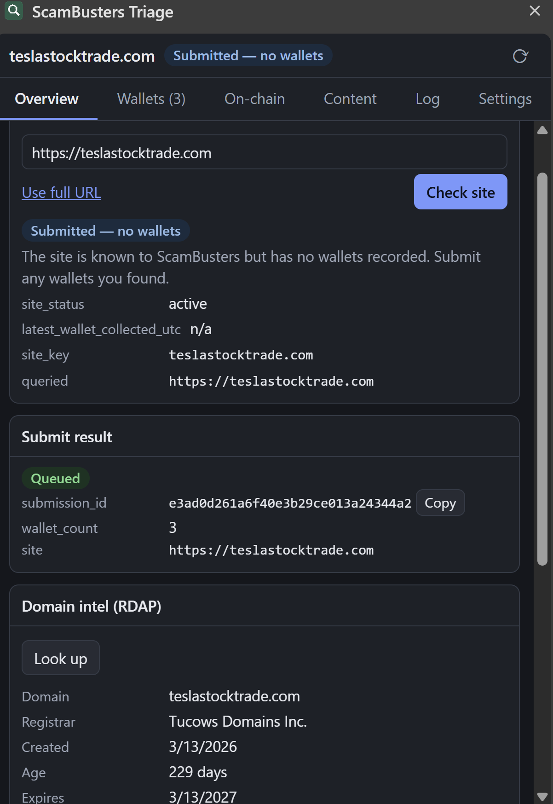
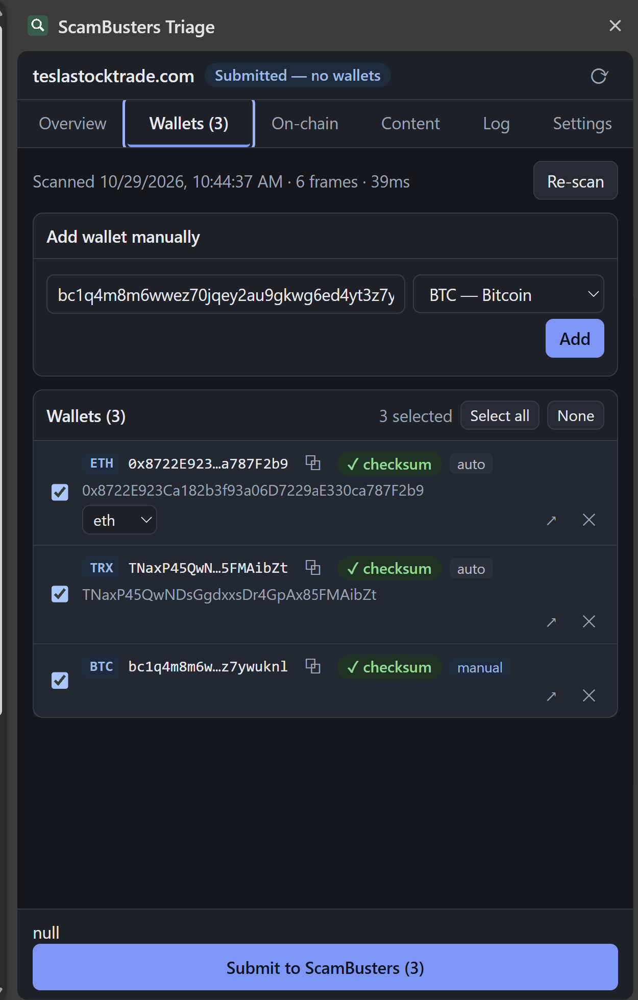
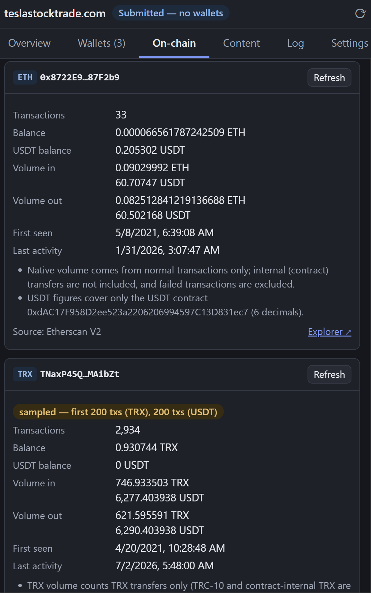
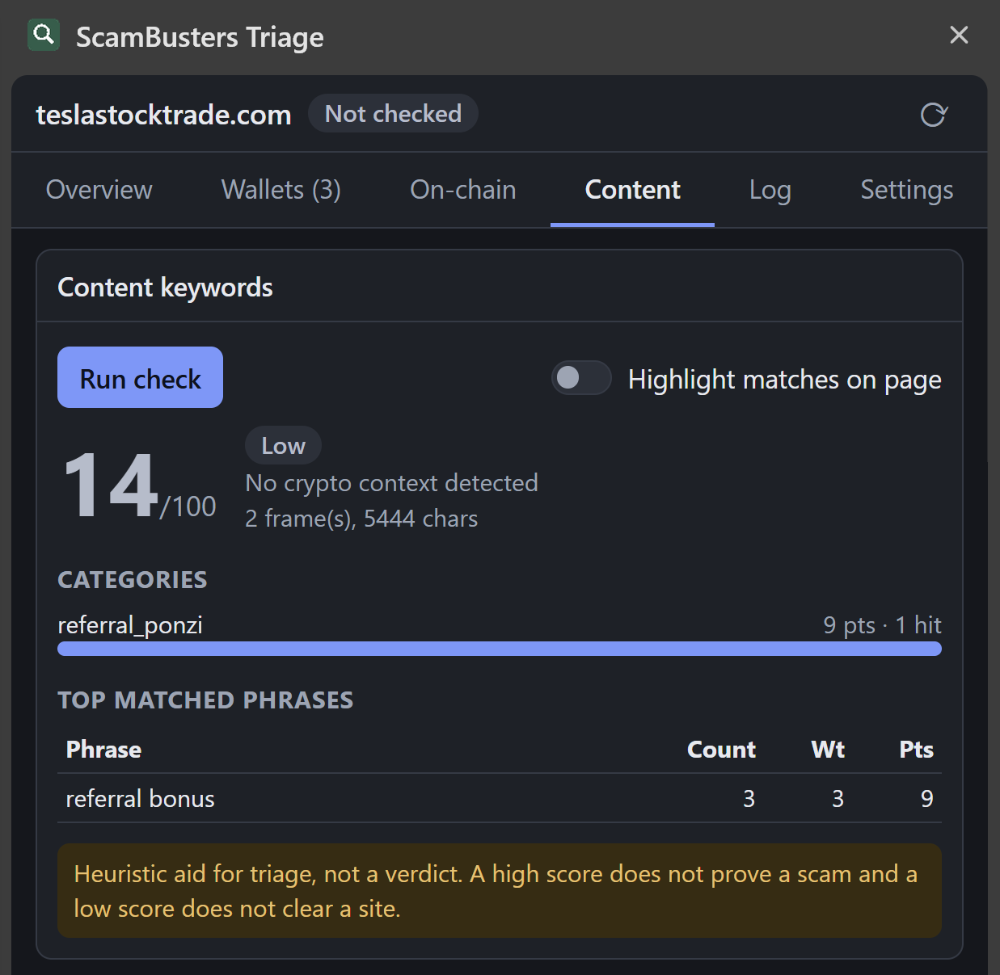
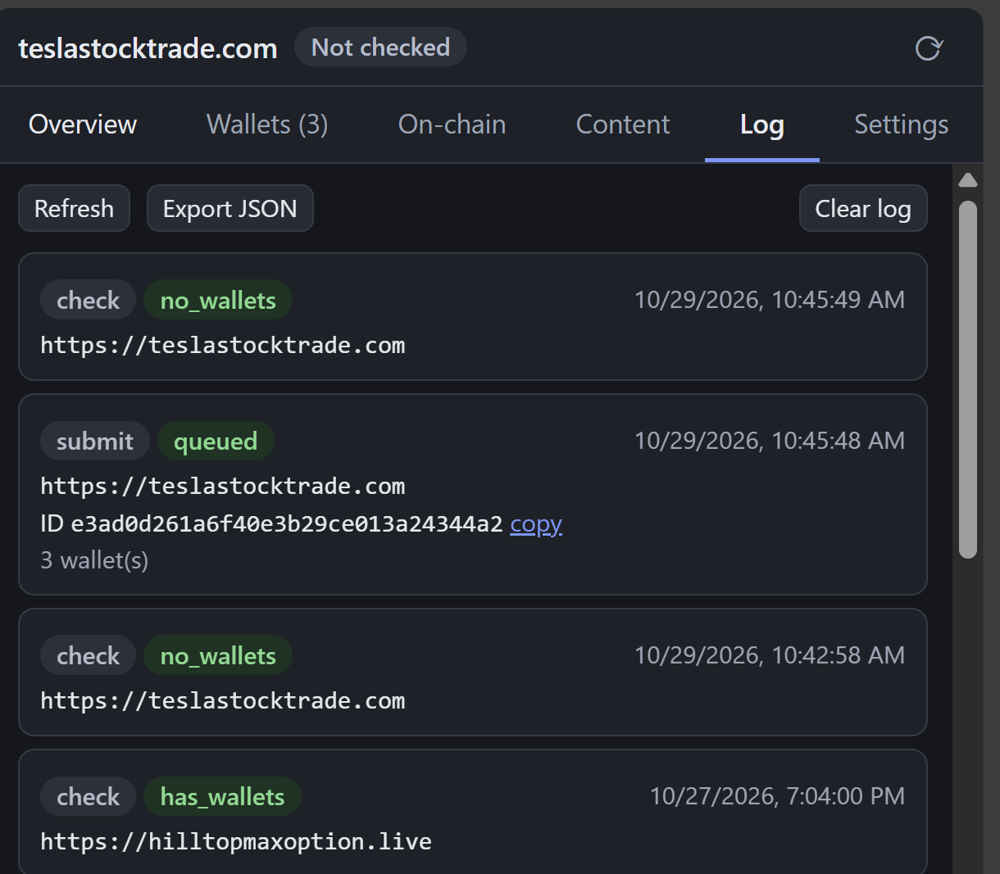

# ScamBusters Triage

A Chrome side-panel extension for Intelligence for Good ScamBusters students. Open it on a suspected crypto-scam site and it will:

- **Find wallet addresses** on the page and check them with real checksums (15 chains)
- **Check the site in ScamBusters** and submit it, with or without wallets
- **Look up on-chain activity** and public name labels for each wallet
- **Score the page text** for scam language
- **Show domain age** (RDAP) and URLScan results
- **Fill sign-up and login forms** with a throwaway identity, so registering on a scam site takes one click

No build step: plain ES modules and CSS.

| Overview | Wallets |
|---|---|
|  |  |

| On-chain | Content | Log |
|---|---|---|
|  |  |  |

## Install

You need Chrome 116 or later.

1. Download or clone this repository.
2. Open `chrome://extensions` and turn on **Developer mode**.
3. Click **Load unpacked** and choose the `scambusters-triage` folder.
4. Pin the extension, then click its icon on any page. The side panel opens and scans that tab.
5. Open **Settings** and paste your API keys (see below).

Optional: in Settings, click **Allow on all sites** to scan automatically on page load and follow tab switches. Without it, click the icon on each tab.

## API keys

Only the ScamBusters key is required. The others unlock extra features.

| Service | Used for | Get it |
|---|---|---|
| ScamBusters (required) | Check and submit | `/get-api-key` in the ScamBusters Discord. Expires after 30 days; use `/rotate-api-key`. |
| URLScan | "Scan now" (search works without a key, but is rate-limited) | https://urlscan.io/user/profile/ |
| Etherscan | ETH, Polygon and Arbitrum lookups | https://etherscan.io/myapikey |
| Tronscan | TRX lookups | https://tronscan.org/#/myaccount/apiKeys |
| Blockchain.com | Optional; BTC works without it | https://www.blockchain.com/explorer/api/api_create_code |

Keys are stored only in your browser (`chrome.storage.local`), never logged, and each is sent only to its own service. Etherscan only accepts keys as a URL parameter; the others use headers.

### Submitting needs approval

A valid key lets you **check** sites. To **submit**, your student account must be approved: push your code to GitHub, invite **smabryCFRL** (Sam Mabry) as a collaborator, then DM Sam Mabry (I4G) in Discord with the repo URL. The panel tells you whether a 403 means "not approved" or "key expired".

## How to use it

1. **Overview:** check the site in ScamBusters, look up domain age, search or run a URLScan.
2. **Wallets:** review the detected wallets. Add missing ones by hand, remove false positives, and fix the chain on ambiguous `0x…` addresses.
3. **On-chain:** look up balances, volume, first and last activity, and name labels. Red labels (scam, phishing, sanctioned) are flagged on Overview.
4. **Content:** run the keyword check. The score is a triage aid, not a verdict.
5. **Submit:** use the button at the bottom to send the site, with the selected wallets, to ScamBusters.
6. **Autofill:** see "Autofill" below.
7. **Log:** every check, submission and autofill, with IDs you can copy or export.

## Autofill

The **Autofill** tab pre-fills sign-up and login forms so you can register on a scam site quickly.

**Profile.** Editable, with **Reset to defaults**:

| Field | Default |
|---|---|
| Username | `username1202` |
| Email | `example@example.com` |
| Password | `Password1*` |
| Phone | `2025550123` |
| Country | `United States of America` |
| Deposit amount | `100` |

**Extra fields** (empty by default, only filled if you set them): first and last name, birth date, street address, city, state, ZIP, and custom `label = value` lines that fill any field whose label, name or placeholder contains the label.

**When it fills.** Automatically, but only while the side panel is open and the page looks like a sign-up or login page: the URL contains login, log-in, signin, signup, sign-up, register, registration, join, create-account and similar. With "Also detect forms without a sign-up URL" on (the default), any page with a visible password field also counts. It also catches forms that appear later (multi-step flows, pop-ups). Close the panel and nothing fills.

**Deposit pages.** When the URL (deposit, top-up, add-funds, recharge) or a page heading says deposit, amount boxes get the deposit amount. It is raised to the field's minimum, written as `100.00` if the box shows decimals, and a starter `0` counts as empty. Withdrawal, address, wallet, quantity and card fields are never touched, and it never clicks Pay. Preset amount buttons and dropdowns are left to you.

**Buttons on the "This page" card.** **Fill now** works on any page, **Detect fields** previews what would be filled without changing anything, and **Undo** restores the previous values.

**Behavior toggles.**
- Auto-fill on page load (on by default).
- Detect forms without a sign-up URL (on).
- Fill deposit amounts (on).
- Tag the email per site, `example+shopx@example.com` (off). Later spam then traces back to the scam site. Some sites reject `+`.
- Tag the username per site, `username1202shopx` (off).
- Outline filled fields (on).
- Tick "I agree to the terms" boxes (off). Marketing and newsletter boxes are never ticked.

**What it will not do.** It never submits a form. It skips hidden or trap fields, fields that already contain text, footer newsletter boxes and fields outside the sign-up form. Suggestion-style dropdowns (a typed country box, say) are reported as "pick manually". Third-party iframes are never filled.

Auto-fill on page load needs the same **Allow on all sites** permission as auto-scan. Without it, **Fill now** still works on the tab you opened the panel from. Every fill is recorded in the **Log** tab with the email and username used.

The profile is stored in plain text in this browser, like your API keys. Use throwaway details only, never a real password.

## Supported chains

| Wallet checksum | On-chain lookup |
|---|---|
| BTC, ETH and EVM (BSC, Polygon, Arbitrum, Avalanche, Optimism), TRX, XRP, LTC, DOGE, DASH, BCH, ADA, SOL | ETH, Polygon, Arbitrum (Etherscan), BTC, TRX, XRP, SOL, LTC, DOGE, DASH. BSC, Avalanche and Optimism give balance only (free Etherscan tier). BCH and ADA show an explorer link only. |

SOL addresses have no checksum, so they are marked **unverified**. EVM addresses default to ETH; nearby text such as "BEP20" only suggests another chain.

## Privacy and security

- Scanning only reads the page, and page content never leaves your browser. Autofill is the one feature that writes to a page: it sets values in sign-up and login fields, and nothing else.
- Your autofill profile goes only into a tab that matched a sign-up or login page. It is never sent to a server, never written to the log (the password is never logged), and never put into third-party iframes.
- Nothing is sent anywhere unless you click. The page URL goes to URLScan only when you click **Scan now** (unlisted by default). Wallet addresses go to block explorers only for lookups.
- All page data is treated as hostile and rendered as plain text (no `innerHTML`).
- Wallets are re-validated right before submit, so an invalid one can never be sent.
- Permissions: `storage`, `activeTab`, `scripting`, `sidePanel`, `contextMenus`, host access to the API hosts listed in `manifest.json`, and optional all-sites access that you grant yourself.

## Known limits

- Auto-scan and auto-fill on page load need the optional all-sites permission.
- Autofill cannot drive custom (non-native) dropdowns or typed suggestion boxes, CAPTCHAs or verification codes; it leaves those to you.
- Cross-origin iframes are not scanned unless that origin is accessible.
- Volumes are sampled (first 200 to 2,000 transactions) and labelled as such. There is no USD conversion.
- Domains whose TLD has no RDAP service (.io, .co, .me, .ru) show "no RDAP data".
- Byron-era ADA addresses are not accepted.
- ScamBusters rate-limit countdowns (60 s per minute, 15 min per hour) are our assumption; the API sends no `Retry-After`.

## For developers

```
npm test                          # validators, keywords, providers (mocked), content and autofill (jsdom)
node test/smoke/run-smoke.mjs     # live read-only provider calls; needs test/.env.test
node test/e2e/run-e2e.mjs <thisDir> <dir containing node_modules/puppeteer-core>
```

- `DESIGN.md` has the message protocol and data shapes.
- `background/` is the service worker (all network calls, queueing, caching, per-tab state). `content/content.js` is the read-only page scanner; `content/autofill.js` is the only script that writes to pages. `sidepanel/` is UI only. `lib/` holds validators, providers and keyword scoring.
- `test/autofill-fixture.html` is a sign-up form with traps (hidden fields, confirm password, country and dial-code selects, footer newsletter). The autofill content tests run against it under jsdom (set `SB_JSDOM_PATH`, as for the content test).
- `test/fixture.html` is a fake scam page with valid addresses for every chain. Serve it (`npx http-server test`) and open it with the extension loaded.
- `test/.env.test` holds your own Etherscan and Tronscan keys for live tests (`ETHERSCAN_API_KEY=…`, `TRONSCAN_API_KEY=…`). It is gitignored; never commit it.
- Vendored code: `lib/vendor/noble-hashes/` is `@noble/hashes` 1.8.0 (MIT) with one import path changed so it loads without a bundler.
